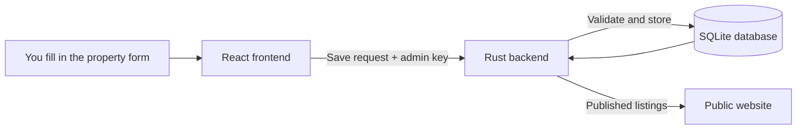

# Your frontend and backend: a practical guide

The frontend is the shop window. The backend is the office that controls the property records. The database is the filing cabinet that remembers them.

For this product:

| Part | What it does | How you control it |
| --- | --- | --- |
| React / Next.js frontend | Displays homes, the railway, station plates and forms | Change React components and CSS; run `npm run dev:frontend` |
| Rust backend | Validates and saves listings, projects, GLBs and scene packages; controls who can change them | Use `/admin` for data; edit Rust code for new API behavior; run `npm run dev:backend` |
| SQLite database | Keeps records after restarts | Let the admin page update it; privately back up `backend/data/` |

## Start and stop

In Terminal, open this project folder. `npm run dev` starts both parts. Visit `http://127.0.0.1:4173`. Press Control-C in that Terminal to stop the processes it started.

To learn the separation, use two Terminal windows:

- Window 1: `npm run dev:backend`. Leave it open. This starts Rust on port 4000.
- Window 2: `npm run dev:frontend`. Leave it open. This starts Next.js on port 4173.

The number after the colon is a port: it tells your computer which program should receive a request. Visitors use the frontend port. The frontend forwards `/api/`, `/uploads/` and `/scene-assets/` requests to Rust.

Stopping just the frontend leaves the backend and its database running. Stopping just the backend leaves the page design available, but it cannot load or save live property data. Neither action deletes the database.

## Add or edit homes without coding

1. Open `http://127.0.0.1:4173/admin`.
2. Run `npm run admin:key` in another Terminal and copy the key into the login box.
3. Fill in the property form and click Add property.
4. A draft is private. Check Published when it is ready for visitors.
5. Check Featured to include it in the homepage selection. The lowest display-position values win the scrolling homepage collection.
6. Use Edit to change details. Use Unpublish to hide a listing temporarily. Use Archive to remove it from the active collection while preserving it. Use Restore to bring it back.
7. Refresh the public page to check the result.

Photo uploads are saved on your computer in `backend/data/uploads/`. The database remembers their paths. Keep this folder when backing up or moving the product.

## Change the design

The open `app/page.jsx` file fetches the latest catalogue and hands it to the React homepage. The visible page layout is in `components/HomePage.jsx`.

- Move or rename page sections: `components/HomePage.jsx`.
- Change fonts, colors, spacing or location markers: `app/globals.css`.
- Change station buttons or error messages: `components/RailwayExplorer.jsx`.
- Change the map route or train speed: `lib/railway.js`.
- Change the aerial descent, its timing or the finishing side: `lib/camera-flight.js`.
- Change terrain height and city building volumes: `lib/landscape.js`.
- Change management form fields: `components/PropertyManager.jsx`.

With `npm run dev` running, frontend edits refresh automatically. Edit a small thing, save, and inspect it in your browser. Add properties through the property desk instead of editing seed data.

## Change backend behavior

`backend/src/main.rs` defines the API and storage rules. For example, this is where a new mandatory field or a new property-search endpoint belongs.

After changing Rust source, stop its Terminal with Control-C and run `npm run dev:backend` again. Cargo recompiles changed Rust files before starting. Run `npm run test:backend` to check the data behavior.

`backend/seed.json` initializes a brand-new database once. Editing it does not overwrite existing saved listings. This protects changes you made through the admin page.

## Common problems

| What you see | What to check |
| --- | --- |
| Property service is offline | Start Rust; check `http://127.0.0.1:4000/api/health` |
| The page will not open | Start Next.js; use port 4173 rather than 4000 |
| Address already in use | Another server is running; stop the old Terminal or use `AERO_FRONTEND_PORT=4175 npm run dev` |
| Rust/Cargo not found | Open `Setup Rust.command` once, then restart |
| Admin key rejected | Use the key from this project's running backend, not a different project |
| Saved property does not appear | Check Published, Featured and display position, then refresh |
| Browser shows old code | Restart the old server with the updated launcher; refresh the page |

The admin key is a password for the local management desk. Keep it private. When you later host the product for a team, add individual accounts, deployment configuration and a backup routine. You do not need those steps to add listings locally now.

## New collection and train controls

- Set a property's construction stage in `/admin`; Rust saves it with the rest of the listing. Old entries can remain Not specified.
- The bedroom and stage controls below the hero filter both property rows immediately.
- Design placeholders come from `lib/property-collection.js` and are never inserted into the database. Add published, featured inventory to replace them.
- Edit the train through `models/mumbai-ac-local.blend`, or change the repeatable geometry script `scripts/build-ac-local.py`. `npm run model:export` regenerates the GLB from that script, overwriting the generated model. To preserve manual Blender edits, export them as `public/models/mumbai-ac-local.glb` instead of running the generator. Keep the root names AC_Driving_Cab and AC_Local_Coach and the bogie/wheel pivot hierarchy so the railway animation can bind them.
- `npm run model:render` regenerates the model and the Blender preview. Restart `npm run dev` after backend source changes, then refresh the page.

## 3D projects and interactive code

The new project desk in `/admin` manages city-catalog projects separately from homepage featured residences. Create a project, choose an upload category, drop GLBs/plans/images or a built viewer ZIP, then choose **Use as opening scene**. There is also a complete-HTML code box. The backend stores browser-ready viewer files; it does not run uploaded source code on the server.

Uploaded 3D assets live in `backend/data/scene-assets/`; records and manifests live in SQLite. Preserve the whole private `backend/data/` directory when backing up. `backend/src/projects.rs` implements these APIs; `components/ProjectAssetManager.jsx` implements the upload desk. Follow [3D-PROJECT-GUIDE.md](3D-PROJECT-GUIDE.md) for the full workflow.

Public browsing now follows station → city catalog → project → rotating colony. The imported Sai World Dreams model is the temporary single catalog project at every station, with its real Dombivli location shown. New projects can be assigned to specific stations in the admin form.
